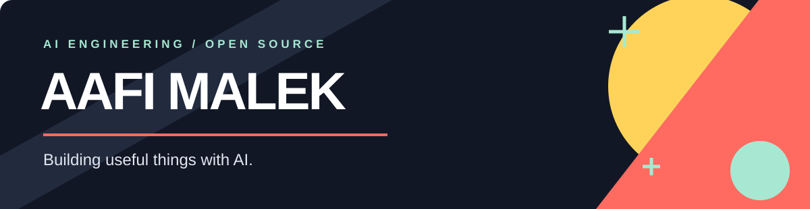

  

  <strong>AI/ML engineer building agents, retrieval systems, and products people can use.</strong> 
  Open to full-time AI engineering opportunities.

  
  
  
  

## What I work on

I build across the AI product stack, from model-powered workflows and backend APIs to the interfaces people use. My work includes **LLM agents and tools**, **RAG and GraphRAG**, **speech recognition and voice**, and **machine learning**. I care about evaluation, observability, and making systems useful beyond the demo.

**Core tools** · Python · FastAPI · TypeScript · React · LangGraph · MCP · PostgreSQL · Docker

## Selected projects

<table>
<tr>
<td width="50%" valign="top">
<h3><a href="https://github.com/Aafimalek/csv_chat">QueryCSV ↗</a></h3>
Ask questions about a CSV in plain language. The app generates Python for analysis and runs it in the browser with Pyodide.
  <code>Python</code> <code>FastAPI</code> <code>TypeScript</code> <code>Pyodide</code>
</td>
<td width="50%" valign="top">
<h3><a href="https://github.com/Aafimalek/prompt_to_animate">Prompt to Animate ↗</a></h3>
A prompt-to-animation project using an LLM generation pipeline, Manim rendering, and a queued worker.
  <code>Python</code> <code>FastAPI</code> <code>Next.js</code> <code>Manim</code>
</td>
</tr>
</table>

## Open source

I contribute fixes, features, and documentation to tools I use. A few recent pull requests:

- **Unsloth** · [Record audio directly for chat models](https://github.com/unslothai/unsloth/pull/16078)
- **browser-use** · [Defer creation of the default download directory](https://github.com/browser-use/browser-use/pull/6243)
- **mcp-use** · [Isolate elicitation array defaults](https://github.com/mcp-use/mcp-use/pull/3000)

[See all my pull requests ↗](https://github.com/pulls?q=is%3Apr+author%3AAafimalek)

---

<strong>Building an AI product or looking for an AI engineer?</strong> 
<a href="mailto:aafimalek2023@gmail.com">Let's talk by email</a> · <a href="https://linkedin.com/in/aafi-malek">Connect on LinkedIn</a>

