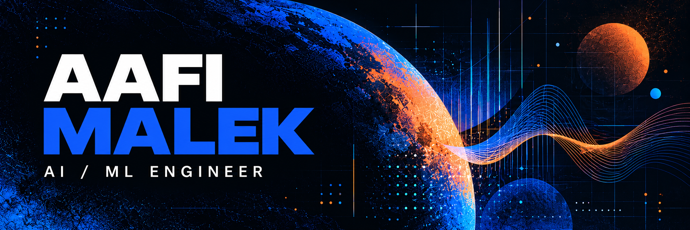

<strong>AI agents · retrieval · speech · product engineering</strong> 
Open to full-time AI engineering opportunities.

<a href="mailto:aafimalek2023@gmail.com">Email</a> &nbsp; / &nbsp; <a href="https://linkedin.com/in/aafi-malek">LinkedIn</a> &nbsp; / &nbsp; <a href="https://x.com/aafimalek2032">X</a> &nbsp; / &nbsp; <a href="https://medium.com/@Aafimalek">Medium</a>

I build AI applications across the stack, from agent workflows and retrieval systems to APIs and the interfaces people use. My work includes speech recognition, machine learning and voice applications, with an eye on evaluation and observability.

## Open-source contributions

I contribute features, fixes and documentation to open-source AI tools. These links lead to my pull requests and their discussions.

<table>
<tr>
<td width="50%" valign="top">

<h3><a href="https://github.com/unslothai/unsloth">Unsloth ↗</a></h3>
Audio recording for chat models and generation-time metadata in Studio.
  <a href="https://github.com/unslothai/unsloth/pull/16078">Audio recording · PR #16078</a> 
<a href="https://github.com/unslothai/unsloth/pull/16462">Image timing · PR #16462</a>
</td>
<td width="50%" valign="top">

<h3><a href="https://github.com/browser-use/browser-use">browser-use ↗</a></h3>
Download-directory lifecycle improvements and clearer parallel test guidance.
  <a href="https://github.com/browser-use/browser-use/pull/6243">Download lifecycle · PR #6243</a> 
<a href="https://github.com/browser-use/browser-use/pull/6282">Testing docs · PR #6282</a>
</td>
</tr>
<tr>
<td width="50%" valign="top">

<h3><a href="https://github.com/mcp-use/mcp-use">mcp-use ↗</a></h3>
Isolate mutable array defaults in the TypeScript client's elicitation helpers.
  <a href="https://github.com/mcp-use/mcp-use/pull/3000">Elicitation defaults · PR #3000</a>
</td>
<td width="50%" valign="top">

<h3><a href="https://github.com/anomalyco/opencode">OpenCode ↗</a></h3>
Wait for plugin activation before looking up integrations.
  <a href="https://github.com/anomalyco/opencode/pull/59851">Integration activation · PR #59851</a>
</td>
</tr>
</table>

[Explore all my pull requests →](https://github.com/pulls?q=is%3Apr+author%3AAafimalek)

## Tools I work with

<strong>AI & machine learning</strong> 

<strong>Languages & product</strong> 

<strong>Data & infrastructure</strong> 

---

## Let's connect

Building an AI product or hiring an AI engineer? I'd like to hear about it.

**[Email me](mailto:aafimalek2023@gmail.com)** &nbsp; · &nbsp; **[Connect on LinkedIn](https://linkedin.com/in/aafi-malek)**

