<p align="center">
  <a href="https://github.com/Aafimalek">
    
  </a>
</p>

<p align="center">
  <picture>
    <source media="(prefers-color-scheme: dark)" srcset="assets/terminal-dark.svg">
    <source media="(prefers-color-scheme: light)" srcset="assets/terminal-light.svg">
    
  </picture>
</p>

<p align="center">
  <a href="mailto:aafimalek2023@gmail.com"></a>
  <a href="https://linkedin.com/in/aafi-malek"></a>
  <a href="https://x.com/aafimalek2032"></a>
  <a href="https://medium.com/@Aafimalek"></a>
  
</p>

```python
class Aafi(Engineer):
    based_in   = "Ahmedabad, India 🇮🇳"
    builds     = ["AI agents", "RAG pipelines", "speech & voice apps", "the UI around them"]
    side_quests = {
        "rl":   "small models that play Wordle, Atari, Snake & Flappy Bird",
        "math": "Lean 4 proofs on open problems (Erdős #385, Fink's conjecture...)",
    }
    believes   = "if it isn't evaluated, it doesn't work yet"
    status     = "open to full-time AI engineering roles ✅"

    def ping(self):
        return "aafimalek2023@gmail.com"  # yes, it actually works
```

## 🧮 Side quest: proving things

Lately I've been pointing AI at open math problems and making it **show its work in Lean 4**, so a proof checker (not vibes) decides if it's right.

| | Result | Receipts |
|---|---|---|
| 🔢 | [Fink's conjecture on recursive divisors](https://github.com/Aafimalek/fink-recursive-divisors) | Lean 4 proof + exact check to 10⁶ |
| 🎲 | [Erdős #385 & #430 hold for *almost all* n](https://github.com/Aafimalek/erdos-385-almost-all) | Lean 4 density theorems |
| 🟦 | [The first sizes above the Latin-square bound](https://github.com/Aafimalek/latin-square-gap) | Lean 4 gap theorem + exhaustive checks |
| 🎖️ | [Euler's 36 officers, small maximal arrangements](https://github.com/Aafimalek/novel-discoveries/tree/main/euler-36-officers-disconnected) | Lean 4 witness + 13 SAT certificates |

<sub>All AI-assisted and machine-checked. Full write-ups in <a href="https://github.com/Aafimalek/novel-discoveries">novel-discoveries</a>. Spot a bug or an earlier proof? Open an issue, I'd love to know.</sub>

## 🕹️ I teach small models to play games

<table>
<tr>
<td width="46%" valign="top">

</td>
<td valign="top">

**[wordle-rl](https://github.com/Aafimalek/wordle-rl)** ⭐<br>
Training **Gemma 3 270M** to play Wordle with RL, on *free* GPUs. Code, word lists, evals and a paper.

**[atari_rl](https://github.com/Aafimalek/atari_rl)** ⭐<br>
A DQN (straight from the DeepMind paper) that learned Breakout after 6M steps of trial, error and paddle rage.

**[rl_snake_game](https://github.com/Aafimalek/rl_snake_game)** · **[flappy_bird_AI](https://github.com/Aafimalek/flappy_bird_AI)**<br>
Where it all started: a snake that learned not to bite itself and a bird that learned gravity.

> 💡 Fun fact: the board on the left is a scripted replay.
> My real model is still working on getting it in 3.

</td>
</tr>
</table>

## 🛠️ Things I've built

| | Project | What it does |
|---|---|---|
| 🎬 | [prompt_to_animate](https://github.com/Aafimalek/prompt_to_animate) | Type a prompt, get a high-quality 2D animation in seconds |
| 🕸️ | [graphdb](https://github.com/Aafimalek/graphdb) | Talk to a Neo4j graph in plain English (text → Cypher) |
| 📊 | [csv_chat](https://github.com/Aafimalek/csv_chat) | Chat with your CSVs instead of writing pandas |
| 💬 | [t3_chat](https://github.com/Aafimalek/t3_chat) | A T3.chat-style AI chat: LangGraph, web search, multiple models |
| 📚 | [advanced_rag](https://github.com/Aafimalek/advanced_rag) | Retrieval experiments beyond "chunk it and pray" |
| 🧠 | [learning](https://github.com/Aafimalek/learning) | My public logbook of everything I'm learning |

## 🤝 Open-source PRs

<table>
<tr>
<td align="center" width="25%"><a href="https://github.com/unslothai/unsloth"><br><b>Unsloth</b></a><br><sub><a href="https://github.com/unslothai/unsloth/pull/16078">audio recording</a> · <a href="https://github.com/unslothai/unsloth/pull/16462">image timing</a></sub></td>
<td align="center" width="25%"><a href="https://github.com/browser-use/browser-use"><br><b>browser-use</b></a><br><sub><a href="https://github.com/browser-use/browser-use/pull/6243">download lifecycle</a> · <a href="https://github.com/browser-use/browser-use/pull/6282">testing docs</a></sub></td>
<td align="center" width="25%"><a href="https://github.com/mcp-use/mcp-use"><br><b>mcp-use</b></a><br><sub><a href="https://github.com/mcp-use/mcp-use/pull/3000">elicitation defaults</a></sub></td>
<td align="center" width="25%"><a href="https://github.com/anomalyco/opencode"><br><b>OpenCode</b></a><br><sub><a href="https://github.com/anomalyco/opencode/pull/59851">integration activation</a></sub></td>
</tr>
</table>

<p align="center"><a href="https://github.com/pulls?q=is%3Apr+author%3AAafimalek">see all my pull requests →</a></p>

## 🧰 Toolbox

<p align="center">
  
</p>
<p align="center"><sub>+ LangGraph · LangChain · MCP · Neo4j · Qdrant · Lean 4 · whatever the problem needs</sub></p>

## 🐍 My contributions, being eaten

<picture>
  <source media="(prefers-color-scheme: dark)" srcset="https://raw.githubusercontent.com/Aafimalek/Aafimalek/output/github-contribution-grid-snake-dark.svg">
  <source media="(prefers-color-scheme: light)" srcset="https://raw.githubusercontent.com/Aafimalek/Aafimalek/output/github-contribution-grid-snake.svg">
  
</picture>

<details>
<summary>🥚 <b>don't click this</b></summary>
<br>

```text
$ sudo hire aafi
[sudo] password for recruiter: ********

✔ checking skills ............. agents, RAG, speech, RL, Lean
✔ checking vibes .............. immaculate
✔ checking availability ....... open to full-time
✔ checking coffee levels ...... dangerously high

→ next step: mailto:aafimalek2023@gmail.com
```

You found the egg. That makes you the kind of person I'd like to work with. 🫡

</details>

<p align="center">
  <sub>Building an AI product or hiring an AI engineer? <a href="mailto:aafimalek2023@gmail.com"><b>Say hi</b></a>. I reply faster than my RL agents converge.</sub>
</p>
