<p align="center">
  
</p>

<p align="center">
  <picture>
    <source media="(prefers-color-scheme: dark)" srcset="assets/terminal-dark.svg">
    <source media="(prefers-color-scheme: light)" srcset="assets/terminal-light.svg">
    
  </picture>
</p>

<p align="center">
  <a href="mailto:aafimalek2023@gmail.com"></a>
  <a href="https://linkedin.com/in/aafi-malek"></a>
  <a href="https://x.com/aafimalek2032"></a>
  <a href="https://medium.com/@Aafimalek"></a>
  
</p>

## 📈 Activity

<picture>
  <source media="(prefers-color-scheme: dark)" srcset="assets/activity-dark.svg">
  <source media="(prefers-color-scheme: light)" srcset="assets/activity-light.svg">
  
</picture>

## 🤝 Open source

<picture>
  <source media="(prefers-color-scheme: dark)" srcset="assets/oss-dark.svg">
  <source media="(prefers-color-scheme: light)" srcset="assets/oss-light.svg">
  
</picture>

<p align="right"><sub><a href="https://github.com/pulls?q=is%3Apr+author%3AAafimalek+-user%3AAafimalek">browse every PR →</a></sub></p>

## 🧮 Side quest: proving things

I point AI at open math problems and make it **show its work in Lean 4**, so a proof checker (not vibes) decides if it's right.

| | Result | Receipts |
|---|---|---|
| 🔢 | [Fink's conjecture on recursive divisors](https://github.com/Aafimalek/fink-recursive-divisors) | Lean 4 proof + exact check to 10⁶ |
| 🎲 | [Erdős #385 & #430 hold for *almost all* n](https://github.com/Aafimalek/erdos-385-almost-all) | Lean 4 density theorems |
| 🟧 | [The first sizes above the Latin-square bound](https://github.com/Aafimalek/latin-square-gap) | Lean 4 gap theorem + exhaustive checks |
| 🎖️ | [Euler's 36 officers, small maximal arrangements](https://github.com/Aafimalek/novel-discoveries/tree/main/euler-36-officers-disconnected) | Lean 4 witness + 13 SAT certificates |

<sub>Write-ups live in <a href="https://github.com/Aafimalek/novel-discoveries">novel-discoveries</a>. Found a bug or an earlier proof? Open an issue there.</sub>

## 🕹️ Arcade

<picture>
  <source media="(prefers-color-scheme: dark)" srcset="assets/arcade-dark.svg">
  <source media="(prefers-color-scheme: light)" srcset="assets/arcade-light.svg">
  
</picture>

<p align="center"><sub>
  <a href="https://huggingface.co/spaces/aafimalek2032/five-letters"><b>▶ watch the Wordle model play live</b></a> ·
  <a href="https://huggingface.co/aafimalek2032/wordle-rl-gemma3-270m">model</a> ·
  <a href="https://github.com/Aafimalek/wordle-rl/blob/main/paper/main.tex">paper</a> ·
  <a href="https://github.com/Aafimalek/atari_rl">atari_rl</a> ·
  <a href="https://github.com/Aafimalek/rl_snake_game">rl_snake_game</a> ·
  <a href="https://github.com/Aafimalek/flappy_bird_AI">flappy_bird_AI</a>
</sub></p>

## 🛠️ Things I've built

<p align="center">
<a href="https://github.com/Aafimalek/prompt_to_animate"><picture>
  <source media="(prefers-color-scheme: dark)" srcset="assets/project-prompt_to_animate-dark.svg">
  <source media="(prefers-color-scheme: light)" srcset="assets/project-prompt_to_animate-light.svg">
  
</picture></a>
<a href="https://github.com/Aafimalek/csv_chat"><picture>
  <source media="(prefers-color-scheme: dark)" srcset="assets/project-csv_chat-dark.svg">
  <source media="(prefers-color-scheme: light)" srcset="assets/project-csv_chat-light.svg">
  
</picture></a>
<a href="https://github.com/Aafimalek/graphdb"><picture>
  <source media="(prefers-color-scheme: dark)" srcset="assets/project-graphdb-dark.svg">
  <source media="(prefers-color-scheme: light)" srcset="assets/project-graphdb-light.svg">
  
</picture></a>
<a href="https://github.com/Aafimalek/t3_chat"><picture>
  <source media="(prefers-color-scheme: dark)" srcset="assets/project-t3_chat-dark.svg">
  <source media="(prefers-color-scheme: light)" srcset="assets/project-t3_chat-light.svg">
  
</picture></a>
<a href="https://github.com/Aafimalek/advanced_rag"><picture>
  <source media="(prefers-color-scheme: dark)" srcset="assets/project-advanced_rag-dark.svg">
  <source media="(prefers-color-scheme: light)" srcset="assets/project-advanced_rag-light.svg">
  
</picture></a>
<a href="https://github.com/Aafimalek/learning"><picture>
  <source media="(prefers-color-scheme: dark)" srcset="assets/project-learning-dark.svg">
  <source media="(prefers-color-scheme: light)" srcset="assets/project-learning-light.svg">
  
</picture></a>
</p>

## 🧰 Toolbox

<picture>
  <source media="(prefers-color-scheme: dark)" srcset="assets/toolbox-dark.svg">
  <source media="(prefers-color-scheme: light)" srcset="assets/toolbox-light.svg">
  
</picture>

<details>
<summary>🥚 <b>don't click this</b></summary>
<br>

```text
$ sudo hire aafi
[sudo] password for recruiter: ********

✔ checking vibes .............. immaculate
✔ checking evals .............. passing
✔ checking coffee levels ...... dangerously high

→ next step: scroll up, press a badge
```

You found the egg. That makes you the kind of person I'd like to work with. 🫡

</details>

<p align="center"><sub>Building an AI product or hiring an AI engineer? <a href="mailto:aafimalek2023@gmail.com"><b>Say hi</b></a>. I reply faster than my RL agents converge.</sub></p>
